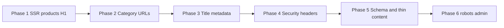

# SEO Audit 1 — Technical remediation plan

**Site:** https://www.junko-fze.com  
**Stack:** Next.js App Router (Junko-Web)  
**Focus:** Technical SEO — improve crawlability, indexation, and headers without major UI or copy rewrites.

This plan is derived from the Screaming Frog (or similar) exports in `docs/seo/` at audit time.

---

## Source exports

| File | What it flags |
|------|----------------|
| `h1_missing.csv` | Pages with no H1 in the crawled HTML |
| `canonicals_canonicalised.csv` | URLs whose canonical points to a different URL (non-indexable) |
| `url_contains_space.csv` | URLs with spaces (often `%20` in query strings) |
| `page_titles_below_30_characters.csv` | Title tags under ~30 characters |
| `content_low_content_pages.csv` | Word count below tool threshold (~200 words) |
| `security_missing_contentsecuritypolicy_header.csv` | Missing `Content-Security-Policy` |
| `security_missing_secure_referrerpolicy_header.csv` | Missing `Referrer-Policy` |

---

## Audit summary

| Export | Scale | Root cause (in this codebase) |
|--------|--------|-------------------------------|
| `h1_missing.csv` | **1 URL** (`/products`) | H1 only in `ProductsClient` (client component). Non-JS crawlers see no H1. |
| `canonicals_canonicalised.csv` + `url_contains_space.csv` | **5 category URLs** | `?category=SEALING%20MACHINES` etc. canonical → `/products`; category names use spaces in query params. |
| `page_titles_below_30_characters.csv` | **~79 product URLs** | `title: product.name` + layout template `%s \| Junko Industrial`; short SKUs; duplicate titles (SM-6, NP-7A, BCM variants). |
| `content_low_content_pages.csv` | **~146 URLs** | `/products` ≈ 16 words (listing client-rendered). Many PDPs ~58–190 words (tool threshold, not necessarily a Google penalty). |
| `security_missing_*` | Many URLs (HTML + `/_next/*`) | No site-wide security headers in `next.config.ts` / middleware. Fix once at response level; asset URLs in CSV are audit noise. |

**Already in good shape**

- `metadataBase`, www redirect in `middleware.ts`
- `robots.ts`, `sitemap.ts`
- Product pages: canonical, Product + Breadcrumb JSON-LD
- Sr-only product link nav on `/products` (discovery; does not fix H1 or word count)

**Key files**

- `src/app/products/page.tsx` — static canonical `/products`
- `src/app/products/ProductsClient.tsx` — filters, H1, grid (client)
- `src/app/product/[id]/page.tsx` — `generateMetadata`, schemas, breadcrumbs
- `src/app/layout.tsx` — title template `%s | Junko Industrial`
- `next.config.ts` — redirects; no `headers()` yet

---

## Strategic choice (drives Phase 2)

Category URLs appear in product breadcrumb JSON-LD (`products?category=…`) but are **canonicalized to `/products`**.

| Strategy | SEO intent | Technical direction |
|----------|------------|---------------------|
| **A — Index category landings** (recommended for industrial catalog) | Rank for category queries (e.g. bag closing machines, sealers) | Self-referencing canonicals, unique titles/descriptions, clean URLs, sitemap entries |
| **B — Consolidate on `/products`** | Single catalog URL in the index | Keep canonical → `/products`; `noindex` on filtered URLs; adjust schema/internal links |

**Default for this plan: Strategy A.** If you choose B, replace Phase 2 with canonical/`noindex`/schema cleanup only (no new category URLs in sitemap).

---

## Phase 1 — Server-rendered `/products` shell (H1 + crawlable listing)

**Fixes:** `h1_missing.csv`, worst of `content_low_content_pages.csv` on `/products`.

**Problem:** `page.tsx` wraps `ProductsClient` in `Suspense`; the H1 in the client header is not in initial HTML.

**Work (minimal UI change — same messaging, SSR where crawlers read)**

1. Add a **server component** block in `products/page.tsx` (or dedicated server-only header):
   - One **`<h1>`**: “All Products” or category name from `searchParams.category` when present.
   - Same subtitle as the client header (explore range / premium machinery).
2. **SSR first page of products** (e.g. 24 items): HTML links matching public URLs (`/product/{slug}`). Client keeps filters, search, pagination.
3. Ensure **only one H1** in the DOM after hydration (server H1 + demote/remove duplicate client H1 if needed).

**Verify**

- View source on `/products`: H1 present without JavaScript.
- Re-crawl: `h1_missing.csv` clear; `/products` word count well above 16.

---

## Phase 2 — Category URL architecture + canonicals (large, standalone)

**Fixes:** `canonicals_canonicalised.csv`, `url_contains_space.csv`, alignment with breadcrumbs and sitemap.

**Problem:** Static metadata forces all filter URLs to `canonical: '/products'`. Categories use display names with spaces in `?category=`.

**Work**

1. **Category slugs** in catalog layer (e.g. `sealing-machines` ↔ `SEALING MACHINES`); display names unchanged in UI.
2. **Clean URLs** (prefer paths):
   - Recommended: `/products/sealing-machines`
   - Alternative: `/products?category=sealing-machines` (still fixes spaces in URL)
3. **Dynamic metadata** per category (and base `/products`):
   - Title, description (short template per category)
   - **`alternates.canonical`**: self-referencing for category; `/products` only when unfiltered
4. **301 redirects** from legacy `?category=SEALING%20MACHINES` → new URL (`scripts/redirects.json` / `next.config.ts`).
5. Update **internal links**: `ProductsClient`, product breadcrumb schema in `product/[id]/page.tsx`.
6. **`sitemap.ts`**: one URL per category (not every `?page=`).
7. **Pagination policy** (document and implement):
   - Page 1: canonical without `?page=`
   - Page 2+: either `noindex, follow` or canonical to page 1 — pick one rule for metadata.

**Verify**

- Category URLs indexable with self-canonical.
- No spaces in canonical category URLs; old URLs 301.
- Sitemap lists categories.

---

## Phase 3 — Product title metadata (small batch)

**Fixes:** `page_titles_below_30_characters.csv`, duplicate titles.

**Problem:** `generateMetadata` uses `title: product.name` with global template in `layout.tsx`.

**Work (metadata only; H1 on page can stay `product.name`)**

1. Title pattern, e.g. `{name} — {subcategory || category} | Junko Industrial` or `{name} | {category} Packaging Equipment`.
2. **Disambiguate duplicates** (SM-6, NP-7A, BCM_1, etc.) using slug or model id in title when names collide.
3. Align `openGraph.title` where useful.
4. Use `title.absolute` only when the template would double-append.

**Verify**

- Titles ≥ 30 characters for previously flagged URLs (where possible).
- Unique titles for former duplicates in crawl export.

---

## Phase 4 — Security / trust headers (small batch)

**Fixes:** `security_missing_contentsecuritypolicy_header.csv`, `security_missing_secure_referrerpolicy_header.csv`.

**Work:** `headers()` in `next.config.ts` (test on staging first).

| Header | Suggested value |
|--------|------------------|
| `Referrer-Policy` | `strict-origin-when-cross-origin` |
| `X-Content-Type-Options` | `nosniff` |
| `X-Frame-Options` | `SAMEORIGIN` (or `frame-ancestors 'self'` via CSP) |
| `Permissions-Policy` | Restrict camera, mic, geolocation as needed |
| `Strict-Transport-Security` | Prefer Vercel/platform defaults; avoid duplicate/wrong max-age |

**CSP (two steps)**

1. **Content-Security-Policy-Report-Only** including: Google Tag Manager / Analytics, Google Fonts, `*.public.blob.vercel-storage.com`, `images.pexels.com`, Next inline requirements for gtag bootstrap.
2. After clean reports in production, switch to enforcing CSP and tighten over time.

**Note:** Ranking impact is minor; audit and security posture improve.

---

## Phase 5 — Low content & structured data (medium, mostly technical)

**Fixes:** remainder of `content_low_content_pages.csv`.

**Priorities**

1. Do **not** treat SF “&lt;200 words” as mandatory for every PDP if DB descriptions are short — focus on **server-rendered** existing copy (PDPs already render description in HTML).
2. **`/products`**: largely addressed in Phase 1.
3. Add **CollectionPage / ItemList** JSON-LD on `/products` (and category pages after Phase 2) — no UI change.
4. Optional: one **SSR sentence** on PDP when description is empty (same spirit as existing fallback copy) — minimal templating, not a full rewrite.
5. **Slug hygiene:** e.g. `pallet-scale-https-junko-fze-com-product-pallet-scale` — fix in catalog/admin, 301 to clean slug.

**Defer:** Rewriting 140+ product descriptions (content project).

---

## Phase 6 — Crawl hygiene (small batch)

Can run with or after Phase 4.

- `robots.ts`: `disallow` `/admin`, `/api/` if those should not be indexed.
- `noindex` on admin layout (optional belt-and-suspenders).
- Confirm sitemap and canonicals use **www** only (aligned with `middleware.ts`).
- Re-crawl: **JS off** for H1/listing regression; **JS on** for parity checks.

---

## Implementation order

| Phase | Effort | SEO impact |
|-------|--------|------------|
| 1 | Medium | High — H1, catalog page |
| 2 | **Large** | **Highest** — categories, canonicals, URLs |
| 3 | Small | Medium — SERP titles, duplicates |
| 4 | Small–medium | Low–medium — audits, trust |
| 5 | Medium | Medium for listing; PDP mostly audit cleanup |
| 6 | Small | Crawl budget / admin |

**Suggested PRs**

1. PR1: Phase 1  
2. PR2: Phase 2 (isolated — routing, redirects, sitemap)  
3. PR3: Phases 3 + 4 (+ 6 if quick)

---

## Success checklist

- [ ] Phase 1: `h1_missing.csv` empty; `/products` word count ≫ 16 (no JS crawl)
- [ ] Phase 2: category canonical/space URL issues resolved; redirects live; sitemap updated
- [ ] Phase 3: short/duplicate title export reduced per policy
- [ ] Phase 4: Referrer-Policy (+ CSP RO or enforced) on document responses
- [ ] Phase 5: Valid ItemList/CollectionPage in Rich Results Test
- [ ] Phase 6: Admin/API not indexed unintentionally

---

## Category URLs flagged in audit (legacy)

These were non-indexable (canonicalised to `/products`) and/or contained encoded spaces:

- `?category=SEALING%20MACHINES`
- `?category=PACKAGING%20TOOLS`
- `?category=BAG%20CLOSING%20MACHINES`
- `?category=BAG%20CLOSING%20THREADS`
- `?category=CONSUMABLES`

Phase 2 should replace or redirect all of the above.

---

*Document: SEO Audit 1 — plan only. Implementation tracked via PRs and re-crawl exports saved as `seo-audit-2` (or dated) when verification runs.*
